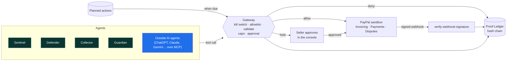

<div align="center">

# 🛡️ AegisFleet

### The brakes for agentic commerce

**Let any AI agent bill and refund on PayPal, without letting it do anything your rules don't allow.**

[](https://aegisfleet.solvor.co.in)
[](https://aegisfleet.solvor.co.in/docs/)
[](#-connect-any-ai-agent-mcp)

[](https://github.com/Shivoo29/AegisFleet/actions/workflows/ci.yml)
[](LICENSE)


   

Built for the **PayPal AI Hackathon 2026**

</div>

---

## 💡 Why

Everyone is building AI agents that move money. Almost nobody is building the brakes. For a solo seller on
PayPal, an agent that can click "refund" is one prompt injection away from emptying the account, and the same
seller already loses money to fake "payment received" emails, disputes they can't answer in time, and invoices
nobody chases.

AegisFleet sits between AI agents and the seller's PayPal account. **AI may read, draft, recommend and plan.
Only rules or a human move money**, and every step is sealed in a ledger nobody can quietly edit.

## ✨ What it does

| | |
|---|---|
| 🚦 **One way to PayPal** | Every action passes the gateway: kill switch → allowlist → argument checks → weekly caps → **human approval** for refunds of $100 or more → execute → seal. |
| 🔗 **Proof Ledger** | Every PayPal event, decision, approval and plan is SHA-256 hash-chained. Edit any past record and verification points at that exact entry. |
| 🤖 **Any AI agent, over MCP** | ChatGPT, Claude, Gemini, Cursor, VS Code or Codex connect with one link and can invoice, remind and refund on real PayPal sandbox, only through the gateway. |
| 🕵️ **Four built-in agents** | Sentinel spots fake payment emails, Defender answers disputes with cited evidence, Collector chases overdue invoices, Guardian keeps tracking and account health in check. |
| 📅 **Agents plan ahead** | Agents book their own next steps on a Bryntum timeline. The seller drags them; when one comes due it runs through the gateway, so a plan that breaks a rule is blocked, not run. |

## 🏗️ How it fits together



## 🔌 Connect any AI agent (MCP)

AegisFleet is an MCP server at `https://aegisfleet.solvor.co.in/mcp` (streamable HTTP).

1. Log in to the console → **Demo → Connect any AI agent → Get my MCP link** (a signed token, valid 14 days).
2. Paste it into your client. The Demo tab shows the exact steps for each one:

| Client | How |
|---|---|
| ChatGPT | Developer mode → Create connector → URL = link, no authentication |
| Claude.ai | Settings → Connectors → Add custom connector |
| Claude Code | `claude mcp add --transport http aegisfleet "<link>"` |
| Antigravity / Gemini CLI | `serverUrl` / `httpUrl` in the MCP config |
| Cursor / Windsurf / VS Code / Codex | `url` in the MCP config |

Claude Code, from a terminal:

```bash
# with the link from the Demo tab
claude mcp add --transport http aegisfleet "https://aegisfleet.solvor.co.in/mcp?token=<your-token>"

# or with your console login
claude mcp add --transport http aegisfleet https://aegisfleet.solvor.co.in/mcp \
  --header "Authorization: Basic $(printf 'judge:<password>' | base64)"
```

Then try: *"Invoice a buyer $150 for a silver bangle."* After it's paid: *"It arrived bent, refund it."*

| Tool | Guardrail |
|---|---|
| `create_invoice` | Real PayPal sandbox invoice, at most $5,000 |
| `send_payment_reminder` | 2 per invoice per week |
| `refund_payment` | Only back to the buyer who paid, never more than PayPal says they paid; $100+ waits for the seller |
| `check_approval` | Did the seller approve it, and what did PayPal return |
| `check_payment_email` | Sentinel checks the email against verified payments, not against what it claims |
| `list_invoices` · `get_history` · `verify_ledger` | Read-only |

Outside agents act as their own gateway identity, `external` ([`mcp_server.py`](backend/app/mcp_server.py)).
The refund bound comes from the ledger ([`refundable_cents`](backend/app/gateway/rules.py)): verified payments minus
refunds already made or waiting for approval.

## 🕵️ The four agents

| Agent | Trigger | Job | Hard boundary |
|---|---|---|---|
| **Sentinel** | Suspicious "payment received" email | Checks sender and amount against verified ledger payments; flags lookalikes, urgency, off-platform asks, overpayment and prompt injection. | Read-only. Never calls a tool or moves money. |
| **Defender** | Dispute opened | Gathers sealed payment, tracking and delivery records, classifies the claim, writes the note to PayPal, recommends evidence, refund or accept. Books a re-check 48 h before PayPal's deadline. | The AI note is used only if every `ledger #N` it cites is real evidence. Evidence, offers and refunds wait for a human. |
| **Collector** | `invoice.overdue` | Scores risk with rules, picks tone and action, sends a capped reminder, books a follow-up and a final notice. | No new amount, discount or waiver. Payment cancels its plans. |
| **Guardian** | Payment, shipment, delivery | Registers tracking, marks delivery, books a carrier check, scores account health. | Health score is rule-based; every appeal line cites a ledger entry. |

## 🔒 Safety invariants

- Agents get an `AgentContext`, not a database or PayPal client: only `ctx.tool()`, `ctx.llm()`, `ctx.plan()` and `ctx.ledger_find()`.
- The gateway checks the kill switch (fails closed), allowlist, arguments and caps; money out above the threshold is held for a human.
- Model output is validated against Pydantic schemas, retried once, then replaced by rules.
- Email and dispute text is untrusted data: fenced in prompts, never followed as instructions.
- PayPal `live` mode is refused in code. Every write carries a `PayPal-Request-Id`, so a retry never double-acts.

## 🧪 Evals (real model)

```bash
cd backend
python -m evals.run --agent all --reset
```

| Suite | n | Result |
|---|---:|---|
| Sentinel | 20 | 20/20, 0 scams missed, 0 false alarms |
| Defender | 8 | 8/8 action, 8/8 classification, 0 uncited facts, 8/8 AI-written notes passed the citation check |
| Collector | 10 | 10/10 risk, 10/10 tone, 10/10 action |
| Prompt injection | 6 | 6/6 flagged, 0 tool calls, 6/6 disallowed tools denied |

Full run with notes: [`docs/evals/2026-11-10-groq.md`](docs/evals/2026-11-10-groq.md). Groq → Gemini → NVIDIA fallback chain.

## 🧰 Built with

| Layer | Tools |
|---|---|
| PayPal (sandbox) | Invoicing v2 (create, send, remind, record payment, record refund), Payments v2 capture refunds, Webhooks + `verify-webhook-signature`, Disputes, Shipment Tracking |
| AI | Groq `openai/gpt-oss-120b`, Gemini `gemini-3.5-flash`, NVIDIA NIM `nemotron-3.5-super-vl-120b-a12b`, MCP Python SDK |
| Backend | Python 3.12, FastAPI, PostgreSQL (Neon), psycopg 3 |
| Frontend | React 18, Vite, TypeScript, Motion |
| Sponsor tools | **Bryntum Scheduler** (agent timeline) · **AG Grid** (ledger, invoices) · **APIMatic** (docs portal, SDKs) · **Render** (hosting) |

The models never call PayPal and never hold credentials; the gateway decides what runs.

## 🚀 Run it locally

```bash
docker compose up -d db                      # Postgres

cd backend
python -m venv .venv && . .venv/bin/activate
pip install -r requirements.txt
pytest -q                                    # 75 tests
uvicorn app.main:app --reload

cd ../frontend && npm install && npm run dev # http://localhost:5173
```

Copy `.env.example` to `.env`. `PAYPAL_MODE=fake` and `LLM_PROVIDER=fake` are the defaults, so it runs with no
keys. More in [`SETUP.md`](SETUP.md).

## 📚 API, docs portal and SDKs

- **Docs portal** (APIMatic): https://aegisfleet.solvor.co.in/docs/, with a live playground, an MCP page and `llms.txt`.
- **SDKs:** [`apimatic/sdk/python`](apimatic/sdk/python), [`apimatic/sdk/typescript`](apimatic/sdk/typescript).
- **OpenAPI:** [`docs/api/openapi.json`](docs/api/openapi.json), live at `/openapi.json`; a test fails if it drifts. Swagger UI at `/swagger`.

## 🗂️ Repo map

```
backend/app/
  gateway/       rules + the single chokepoint for every tool call
  agents/        sentinel, defender, collector, guardian
  mcp_server.py  MCP tools for outside agents
  plans.py       agent-planned actions and the runner
  ledger.py      hash-chained Proof Ledger
  paypal/        sandbox client, fake client, webhooks
frontend/src/screens/   Overview, Approvals, Ledger, Timeline, Demo, …
apimatic/        docs portal + SDKs
docs/            evals, submission text, video script
```

---

<div align="center">

Made by **SKJ**, **A** and **B** · [MIT License](LICENSE)

</div>
