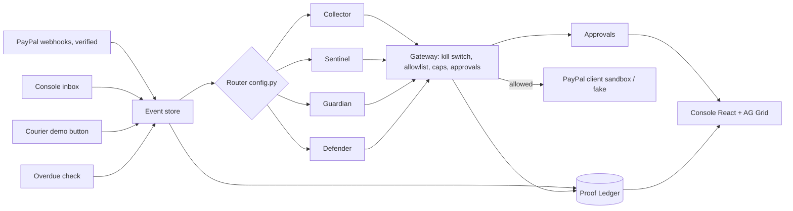

# AegisFleet — High-Level Design

Source of truth for the plan: Notion Team Hub. Source of truth for behaviour: the code. Contracts frozen at M0 (2026-11-02).

## 1. Problem and product

Solo PayPal sellers lose money four ways: late invoices, fake "payment received" emails, held funds, friendly-fraud disputes. Root cause: no proof at the moment it matters.

AegisFleet = 4 agents + 1 hash-chained Proof Ledger + 1 guardrail gateway.
**Rule: AI may draft, classify, recommend. Only rules or a human move money.**

## 2. System diagram

## 3. Modules and owners

| # | Module | Path | Owner | Depends on |
|---|---|---|---|---|
| M1 | Config & flags | `backend/app/config.py` | SKJ | — |
| M2 | DB + schema | `backend/app/db.py`, `schema.sql` | SKJ | M1 |
| M3 | Proof Ledger | `backend/app/ledger.py` | SKJ | M2 |
| M4 | PayPal client + fake | `backend/app/paypal/` | SKJ | M1 |
| M5 | Webhooks + event store + router | `paypal/webhooks.py`, `events.py` | SKJ | M3, M4 |
| M6 | Gateway | `backend/app/gateway/` | SKJ | M3, M4 |
| M7 | LLM wrapper | `backend/app/llm.py` | SKJ | M1 |
| M8 | Console API + demo endpoints | `api.py`, `demo.py` | SKJ | M3, M6 |
| M9 | Agent runtime (`AgentContext`, runner) | `agents/base.py`, `agents/run.py` | SKJ stub → **A** | M6, M7 |
| M10 | Sentinel (P0) | `agents/sentinel.py` | **A** | M9 |
| M11 | Defender (P0) | `agents/defender.py` | **A** | M9 |
| M12 | Collector (P1) | `agents/collector.py` | **A** | M9 |
| M13 | Guardian (P1) | `agents/guardian.py` | **A** | M9 |
| M14 | Datasets + evals | `fixtures/emails|disputes|invoices`, `backend/evals/` | **A** | M10–13 |
| M15 | Console shell (header, nav, auth, polling) | `frontend/src/` | **B** | M8 contract |
| M16 | Screens 2–10 | `frontend/src/screens/` | **B** | M15 |
| M17 | Video, README visuals, Devpost assets | `docs/` | **B** | all |
| M18 | Deploy, CI, seed/reset | `Dockerfile`, `render.yaml`, `.github/`, `scripts/` | SKJ | all |

Teammate detail: [team/A_agents.md](team/A_agents.md), [team/B_console.md](team/B_console.md).

## 4. Key flows

1. **Dispute (M1 thin slice):** `CUSTOMER.DISPUTE.CREATED` → verify signature → store event → seal → Defender → `ctx.tool("provide_dispute_evidence")` → gateway HOLD → approval row → seller approves in console → gateway executes → seal.
2. **Fake payment email:** paste → `POST /api/inbox` → event `email.received` → seal → Sentinel: ledger has no verified payment → `scam` → ship gate stays closed.
3. **Real payment:** webhook verified → seal → invoice paid → ship gate opens.
4. **Shipment:** `POST /api/shipments` → Guardian → `create_shipment_tracking` → demo "delivered" → `update_shipment_tracking` → health recompute.
5. **Overdue:** button → `invoice.overdue` → Collector → reminder (first one to new client = HOLD; max 2/week).
6. **Injection denial beat:** demo replays `create_refund` from an agent → gateway DENY → sealed.

## 5. Trust boundaries

- PayPal webhooks: verified via `verify-webhook-signature` before routing; unverified stored as rejected, never routed.
- Email text, buyer messages: untrusted data, delimited in prompts, never followed.
- Only `paypal/client.py` holds PayPal creds; only gateway calls it.
- `PAYPAL_MODE=live` → app refuses to start.
- `/api/*` behind HTTP Basic (console password).

## 6. Stack

Python 3.12, FastAPI, Pydantic v2, psycopg 3 + plain SQL, httpx. React 18 + Vite + TS + AG Grid Community, fetch + 3 s polling. One Render web service (API serves `frontend/dist`) + Render Postgres. GitHub Actions: pytest + `npm run build`.

## 7. Milestones

| Date | Milestone |
|---|---|
| 11-02 | M0: skeleton + contract stubs on `main`; sandbox spike |
| 11-05 | M1: dispute thin slice live on Render |
| 11-08 | M2: all P0+P1 live; rehearsal |
| 11-10 18:00 | Feature freeze |
| 11-12 20:00 | Submit |

## 8. Git flow

SKJ commits to `main` directly. A works on `a/<topic>`, B on `b/<topic>`, PR to `main`, SKJ reviews (13:00 / 21:00 IST), squash-merge. `main` auto-deploys — unfinished work goes behind a flag.

## 9. Out of scope

Real email integration, accounts/multi-merchant, mobile, OPA/Redis/Celery/LangGraph, live money.
