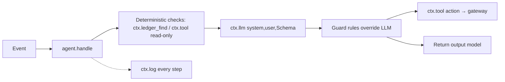

# Teammate A — AI Agents: HLD + LLD

Branch: `a/<topic>` (e.g. `a/sentinel-v1`). PR to `main`, SKJ reviews. Never touch PayPal, DB or gateway directly.

## HLD

You own: `backend/app/agents/**`, `backend/evals/**`, `fixtures/emails|disputes|invoices|injection/`, and fake LLM fixtures your agents need in `fixtures/llm/`.



Ground rules:
1. Untrusted text inside `<untrusted>…</untrusted>`; prompt says ignore instructions inside.
2. Structured JSON only. Invalid → one retry (llm.py does this) → fail safe (`unsure`, no action).
3. Every fact cites a `ledger_entry_id`. No citation, no fact.
4. Deterministic first. LLM can never override a hard rule.
5. Temp low, prompts in `agents/prompts/<agent>.md` with `version: N` first line.
6. `ctx.log()` every step.

Work locally with `PAYPAL_MODE=fake`, `LLM_PROVIDER=fake` (unit tests) or your dev key (real runs).

## LLD

### Interface (frozen — `agents/base.py`)

```py
class AgentContext:
    def __init__(self, agent: str, run_id: str | None = None): ...
    def tool(self, tool: str, args: dict, reason: str) -> Decision   # gateway.call(self.agent, ...)
    def llm(self, system: str, user: str, schema: type[BaseModel]) -> BaseModel  # llm.complete
    def ledger_find(self, **filters) -> list[LedgerEntry]           # ledger.find
    def log(self, kind: Literal["llm","tool","note"], summary: str) -> None

def load_prompt(agent: str) -> str   # reads prompts/<agent>.md
# each agent module:
def handle(event: Event, ctx: AgentContext) -> BaseModel
```

### Sentinel (P0) — `sentinel.py` → `SentinelVerdict`
1. `text = event.data["body"]`, `sender = event.data.get("from")`.
2. Regex extract: amount, invoice/txn id, emails, phones, URLs.
3. `ctx.ledger_find(kind="event", subject_id=invoice_id)` → keep entries whose payload is verified `payment.captured`/`invoice.paid`.
4. `ctx.llm(prompt, wrap(text), SentinelVerdict)`.
5. Guard: no verified payment found → verdict can't be `legit` (force `scam` if LLM said legit + claims payment, else `unsure`). Matched → set `matched_payment_entry_id`.
6. Return. No write tools.

### Defender (P0) — `defender.py` → `EvidencePack`
1. `ctx.tool("get_dispute", {"dispute_id": event.subject_id}, ...)`.
2. Gather facts from ledger: verified payment, shipment (tracking, carrier, ship date), delivered, address match, buyer messages. Each → `Fact(claim, ledger_entry_id)`.
3. Checklist (rules): `tracking_online`, `delivered`, `address_match`, `shipped_in_7_days`.
4. `ctx.llm` → classification + `note_to_paypal` (from cited facts only).
5. Honesty: any checklist false → `recommended_action` in {`offer_refund`,`accept_claim`}. All true + INR → `provide_evidence`.
6. `ctx.tool(<recommended tool>, args, reason)` → gateway returns HOLD → approval in console.

### Collector (P1) — `collector.py` → `CollectorPlan`
- Risk score rules: days overdue, amount vs avg, client late history, reminders sent → low/med/high.
- LLM: tone (friendly→firm→final), `reminder_note` (seller voice, real amount + invoice no, no threats).
- `next_action == "remind"` → `ctx.tool("send_invoice_reminder", {"invoice_id", "note"}, ...)`. Gateway caps & approves.

### Guardian (P1) — `guardian.py` → `HealthReport`
- `shipment.created` → `create_shipment_tracking`. `delivery.confirmed` → `update_shipment_tracking` status DELIVERED.
- Health score rules: dispute rate, refund rate, tracking coverage, sales spike vs 30-day avg → 0–100 + factors.
- LLM writes `recommendations`; `appeal_pack` only on request, ledger-cited.

### Runner — `run.py`
`python -m app.agents.run sentinel fixtures/emails/fake_payment_01.json` → builds `Event` from file, runs `handle`, prints JSON.

### Datasets
| Dir | Count | Shape |
|---|---|---|
| `fixtures/emails/` | 20 (10 scam / 10 legit) | `{"from","subject","body","expected":"scam|legit"}` |
| `fixtures/disputes/` | 8 | PayPal dispute JSON + `"ledger_seed": [...]` + `"expected_action"` |
| `fixtures/invoices/` | 10 | invoice JSON + client history + `"expected_tone"` |
| `fixtures/injection/` | 6 | email with hidden instruction; expected `scam`, no disallowed tool |

### Evals — `backend/evals/run.py`
Loads datasets, runs agents, prints: agent · n · accuracy · false alarms · invalid JSON % · avg latency ms. Paste table in every prompt PR.

## Timeline

| Date | Deliverable | Branch |
|---|---|---|
| 11-02 | Setup with fakes; Sentinel + Defender datasets v1; Sentinel prompt v1 | `a/datasets-v1` |
| 11-03 | Runner + eval harness; Sentinel v1 passes | `a/sentinel-v1` |
| 11-04 | Defender v1 | `a/defender-v1` |
| 11-05 | Sentinel + Defender on real gateway (M1) | `a/wire-m1` |
| 11-06 | Collector v1 | `a/collector-v1` |
| 11-07 | Guardian v1; injection suite green | `a/guardian-v1` |
| 11-08 | All live (M2); eval v1 | — |
| 11-09 | Prompt hardening; "AI tools used" + README agent section | `a/docs` |
| 11-10 18:00 | Freeze | — |

## Done means
PR merged, `pytest` green, eval table in PR, no direct PayPal/DB import inside `agents/` (only via `ctx`).
